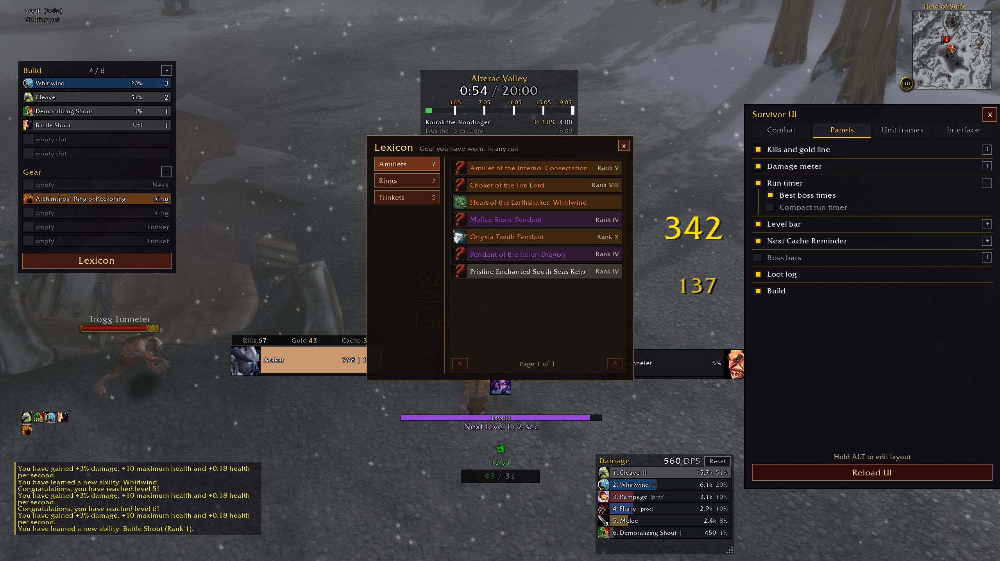

# Azeroth Survivor UI

A lightweight interface addon for **Azeroth Survivors**: flat, dark unit frames, a compact action bar and a set of run panels (damage meter, build, tally, timer, Lexicon) in place of the stock 1.12 look. Everything can be moved, resized and switched off.

## Install

### With the installer (Windows)

Run **`install.bat`** from the repository folder (double-click it). It pulls the latest changes when the folder is a git checkout, then copies `SurvivorUI` into `C:\Git\wenilla\benilla-config\AddOns`.

| Command | What it does |
| --- | --- |
| `install.bat` | Copy the addon into the AddOns folder |
| `install.bat link` | Link the AddOns folder to this repository instead: every `git pull` is in the game after `/reload`, with nothing to copy |
| `install.bat copy "D:\Path\To\AddOns"` | Use another AddOns folder (works with `link` too) |

### By hand

1. Download the latest zip from [Releases](https://github.com/NicholasIzosimov/AzerothSurvivorUI/releases) (or **Code → Download ZIP**).
2. Open the zip and copy the **`SurvivorUI`** folder into your game's `AddOns` folder.
   The result must be `AddOns/SurvivorUI/SurvivorUI.toc`. The folder has to be named `SurvivorUI`, or the game will not load it.
3. Start the game (or `/reload`) and type `/sui opt` for the options.

## Features

- **Unit frames**: flat player and target frames with size, width and height sliders, short health numbers (1.2k) and a band showing your absorb shield on the health bar. Switch off for the game's own frames.
- **Action bar**: one compact row with cooldown numbers (size, color, rounding) and a configurable number of abilities per row.
- **Ability tooltips**: a simplified layout listing each number on its own line, value first (3 Targets, 7 yd, 26% crit · 219% crit damage, 826 Physical Damage, 50% Leech).
- **Buffs**: a centered buff row above the player frame with an optional clock sweep that darkens as a buff runs out; shields with no timer show what they have left to absorb.
- **Damage meter**: muted bars, spell icons and a hover card per line with the average cast and the targets hit.
- **Build**: your spells colored by the rarity their upgrades add up to, your jewelry, and hover cards with upgrades and gear stats.
- **Lexicon**: a book of every amulet, ring and trinket you have worn, across runs, with the classes that wore them, and of your class's abilities with the best average cast each has reached. Click a row of the build to open it at that kind.
- **Tally**: kills, gold, gold per second and gold needed; **Tracker**: run timer with per-class best boss times, speedrun style; **XP bar** with a next-level estimate; **Boss bars**; **Loot log**.
- **Caches**: a reminder and an arrow to the nearest cache (it keeps to one cache until another is 10 yards nearer), plus cache pins on the minimap.
- **Reloads**: boss fight times, the meter's casts and colors, the loot log and the rates are kept through a `/reload` in the middle of a run.

## Commands

| Command | What it does |
| --- | --- |
| `/sui opt` | Options window (also the **UI** button on the minimap) |
| `/sui reload` | Reload the interface |
| `/sui frames` | Addon unit frames on/off |
| `/sui build` | Build panel on/off |
| `/sui lexicon` | Open the Lexicon |
| `/sui meter` | Damage meter on/off |
| `/sui tally` | Tally on/off |
| `/sui timer` | Run timer on/off (`/sui timer compact` for the small one) |
| `/sui xp` | Level bar on/off |
| `/sui caches` | Cache reminder and minimap pins |
| `/sui events` | The game's event banners on/off |
| `/sui sweep` | Buff sweep on/off |
| `/sui nodamage` | Hide all damage numbers (the game's and the addon's) |
| `/sui combattext` | Quick damage numbers or the game's floating combat text |
| `/sui errors` | The game's red error text on/off |
| `/sui hover` | The hover outline on/off |
| `/sui loot` | Loot log on/off |
| `/sui bosses` | Boss bars on/off (`/sui bosses elites` lists elites too) |
| `/sui scale 0.85` | Size of the panels, 0.6 to 1.4 |
| `/sui chat 12` | Chat text size, 8 to 18 |
| `/sui center` | Put the middle block back under the hero |
| `/sui layout` | Put everything back where it started |
| `/sui inspect` | Name the frame under the mouse (for teaching the addon a new piece of the game's interface) |
| `/sui find words` | Name the shown frames whose text holds those words |

Hold **Alt** and drag to move any panel; positions snap to a grid.

The options window has five tabs: **General** (the panels), **Ability Bar** (tooltips, cooldown numbers, buffs), **Text & Numbers** (damage numbers, event and error text), **Unit frames** and **Interface** (level bar, kills and gold, minimap, camera distance, grid).

## Settings

Everything is saved per account in `SurvivorUIDB` (the game's saved variables). Delete that file to start from the defaults.

## License

[MIT](LICENSE)
